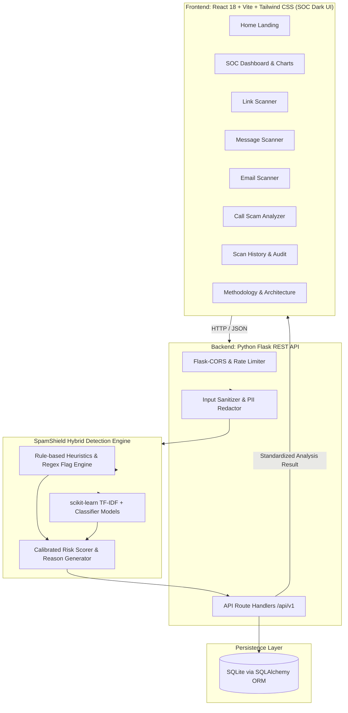

# SpamShield AI – Multi-Channel Spam Detection System
## Comprehensive System Specification & Implementation Plan

> **System Classification:** Defensive Cybersecurity & Threat Intelligence Demo Platform  
> **Target Audience:** College Cybersecurity Evaluation, Defense Demonstrations & Research  
> **Core Principle:** Defensive & Educational — User-provided inputs only, Zero device/inbox surveillance

---

## 1. Executive Summary & Requirements Analysis

### 1.1 Project Objective
**SpamShield AI** is an intelligent, multi-channel defensive detection and threat analysis platform. The system inspects and triages user-provided digital artifacts across four prevalent attack vectors:
1. **URL / Link Scanner:** Phishing URLs, typosquatting, obfuscated links, IP-based URLs, and high-risk TLD lures.
2. **SMS / Message Scanner:** Smishing lures, SMS spam, financial urgency triggers, delivery scams, and fraudulent short-codes.
3. **Email Spam Scanner:** Business Email Compromise (BEC) lures, spam campaigns, credential harvesting text patterns, and spoofed urgent headers.
4. **Call Scam Analyzer:** Vishing (voice phishing) transcript analyzer inspecting urgency, authority impersonation (IRS, police, bank), OTP/gift-card wire demands, and coercive pressure techniques.

### 1.2 Strict Scope Boundaries & Privacy Guardrails
* **No Real-world Interception:** The platform does **not** access the user's phone, SMS inbox, email mailbox, microphone, active calls, contacts, or operating system telemetry.
* **Passive & Defensive Analysis:** URL analysis relies strictly on passive lexical, structural, and heuristic evaluation without executing client-side scripts or browsing dangerous payloads live.
* **Transcript-Only Vishing Module:** The call module processes user-pasted text transcripts or uploaded text/audio-transcript files, accompanied by optional caller metadata (e.g. claimed caller ID or spoofed number).

### 1.3 Standardized Detection Contract
Every detection module must evaluate inputs and return a unified JSON response schema:
```json
{
  "channel": "URL | MESSAGE | EMAIL | CALL_TRANSCRIPT",
  "classification": "SAFE | SUSPICIOUS | MALICIOUS_SPAM | HIGH_RISK_SCAM",
  "risk_score": 87,
  "confidence": 0.94,
  "reasons": [
    "High-urgency language demanding immediate action under threat of legal penalty",
    "Request for untraceable payment method (gift cards / cryptocurrency wire)",
    "Impersonation of federal law enforcement agency"
  ],
  "indicators": [
    { "type": "KEYWORD", "value": "arrest warrant", "severity": "HIGH" },
    { "type": "PAYMENT_METHOD", "value": "Target gift card", "severity": "CRITICAL" },
    { "type": "URGENCY", "value": "within 30 minutes", "severity": "MEDIUM" }
  ],
  "recommendation": "Do not comply or transfer funds. Hang up immediately and report this encounter to your local consumer fraud authority."
}
```

---

## 2. System Architecture & Component Diagram



---

## 3. Project Directory & File Layout

```text
Spam Project/
├── backend/
│   ├── app/
│   │   ├── __init__.py                # Flask application factory
│   │   ├── config.py                  # Environment & DB configurations
│   │   ├── models/
│   │   │   ├── __init__.py
│   │   │   └── scan_record.py         # SQLAlchemy ScanRecord model
│   │   ├── routes/
│   │   │   ├── __init__.py
│   │   │   ├── scan_routes.py         # /api/v1/scan/* endpoints
│   │   │   └── stats_routes.py        # /api/v1/stats/* and history endpoints
│   │   ├── detectors/
│   │   │   ├── __init__.py
│   │   │   ├── base_detector.py       # Abstract Base Detector interface
│   │   │   ├── url_detector.py        # Lexical, structural & domain heuristics
│   │   │   ├── message_detector.py    # SMS / smishing detector (ML + rules)
│   │   │   ├── email_detector.py      # Email spam & phishing detector (ML + headers)
│   │   │   └── call_detector.py       # Vishing transcript analyzer (Coercion/lures)
│   │   ├── ml/
│   │   │   ├── __init__.py
│   │   │   ├── preprocessor.py        # Text tokenization, sanitization & cleaning
│   │   │   ├── model_trainer.py       # Script to train and persist scikit-learn models
│   │   │   ├── models/                # Serialized models (.joblib / .pkl)
│   │   │   │   ├── sms_model.joblib
│   │   │   │   ├── email_model.joblib
│   │   │   │   └── call_model.joblib
│   │   │   └── datasets/              # Training & benchmark corpora
│   │   │       ├── sms_spam_sample.csv
│   │   │       ├── email_spam_sample.csv
│   │   │       └── vishing_sample.csv
│   │   └── utils/
│   │       ├── heuristics_data.py     # Suspicious TLDs, scam dictionaries, regexes
│   │       └── pii_redactor.py        # Redacts phone numbers/emails before logging
│   ├── tests/
│   │   ├── test_detectors.py          # Unit tests for 4 detector modules
│   │   └── test_api.py                # End-to-end endpoint tests
│   ├── requirements.txt               # Flask, SQLAlchemy, scikit-learn, joblib, etc.
│   └── run.py                         # Backend entrypoint (Port 5000)
│
├── frontend/
│   ├── index.html
│   ├── vite.config.js
│   ├── tailwind.config.js
│   ├── postcss.config.js
│   ├── package.json
│   └── src/
│       ├── main.jsx
│       ├── App.jsx                    # Routing & global theme wrapper
│       ├── index.css                  # Tailwind directives & custom cyber aesthetics
│       ├── components/
│       │   ├── common/
│       │   │   ├── Navbar.jsx         # Modern SOC navbar with threat status indicator
│       │   │   ├── Sidebar.jsx        # Navigation links with active route glow
│       │   │   ├── ThreatBadge.jsx    # Safe/Suspicious/Malicious badge
│       │   │   └── LoadingShield.jsx  # Pulse radar scanning animation
│       │   ├── dashboard/
│       │   │   ├── MetricCard.jsx     # Stat counter with trending icon
│       │   │   ├── ActivityChart.jsx  # Recharts scan trend over time
│       │   │   ├── ChannelPieChart.jsx# Threat distribution by channel
│       │   │   └── RecentScansList.jsx# Quick-action recent threat cards
│       │   └── scanner/
│       │       ├── ScannerInput.jsx   # Textarea / file drop / sample preloader
│       │       ├── RiskGauge.jsx      # Recharts/SVG semi-radial speedometer gauge (0-100)
│       │       ├── IndicatorList.jsx  # Feature breakdown with severity badges
│       │       ├── ReasonsPanel.jsx   # AI-identified rationale cards
│       │       └── ActionGuide.jsx    # Defensive recommendations
│       ├── pages/
│       │   ├── Home.jsx               # Hero, quick scan launchpad, feature grid
│       │   ├── Dashboard.jsx          # SOC Threat Operations Center
│       │   ├── LinkScanner.jsx        # URL scanner interface
│       │   ├── MessageScanner.jsx     # SMS/Smishing scanner interface
│       │   ├── EmailScanner.jsx       # Email spam/lure scanner interface
│       │   ├── CallScanner.jsx        # Vishing transcript scanner interface
│       │   ├── ScanHistory.jsx        # Filterable audit log with export
│       │   └── AboutMethodology.jsx   # Research explanation, metrics & ethics
│       └── services/
│           ├── api.js                 # Axios/Fetch API client
│           └── sampleData.js          # Preloaded realistic test cases for demoing
│
└── docs/
    └── PROJECT_SPECIFICATION.md
```

---

## 4. Machine Learning & Detection Architecture

SpamShield uses a **Two-Tier Hybrid Detection Pipeline** to achieve high interpretability, low latency, and robust defensive categorization.

### 4.1 Tier 1: Deterministic Heuristic Analysis
* **URL Analysis:**
  - Length of URL, hostname length, path depth.
  - Presence of IP address instead of domain name (`http://192.168.1.1/login`).
  - Lexical entropy calculations (Shannon Entropy on domain and path).
  - Suspicious Top-Level Domains (`.xyz`, `.top`, `.click`, `.cam`, `.work`, etc.).
  - Typosquatting / homoglyph / brand impersonation checks (e.g. `paypa1`, `arnazon`, `netf1ix`).
  - Obfuscation techniques (excessive subdomains, encoded characters, `@` prefix tricks).
* **SMS / Smishing Analysis:**
  - Presence of shortened links (`bit.ly`, `tinyurl.com`, `is.gd`).
  - Financial lure triggers (`urgent`, `unclaimed prize`, `account suspended`, `stimulus`).
  - Threat/urgency triggers (`immediate action required`, `legal summons`).
* **Email Analysis:**
  - Header inspection (mismatched reply-to, suspicious sender domain vs display name).
  - High-frequency spam trigger keywords and spam capitalization ratio.
  - Credential harvesting triggers ("verify password", "update payment details").
* **Call Scam (Vishing) Analysis:**
  - Coercion vectors: Authority impersonation (IRS, FBI, Police, Immigration, Social Security Administration).
  - Payment extortion cues: Requests for non-standard payment (Gift Cards, Western Union, Bitcoin ATM, wire).
  - Confidentiality traps: "Do not inform anyone", "Do not hang up this call".
  - Multi-speaker dialogue turn analysis (detecting pressure-and-threat loops).

### 4.2 Tier 2: Machine Learning Classifiers
* **Vectorization:** TF-IDF with `ngram_range=(1, 2)`, sublinear TF scaling, and custom cybersecurity stop-word tuning.
* **Classifiers:**
  - **SMS Model:** `MultinomialNB` & `LogisticRegression` trained on standard SMS Spam corpora augmented with modern smishing samples.
  - **Email Model:** `LinearSVC` / `MultinomialNB` with calibrated probabilities for high-accuracy spam classification.
  - **Call Transcript Model:** `LogisticRegression` with high-frequency n-gram feature importance to quantify pressure tactics.

### 4.3 Tier 3: Score Calibration & Recommendation Engine
The final Risk Score ($0 - 100$) integrates:
$$\text{Risk Score} = \min\left(100, \text{round}\left(0.55 \cdot \text{ML\_Probability} \times 100 + 0.45 \cdot \text{Heuristic\_Penalty\_Sum}\right)\right)$$
* **Risk Categorization:**
  - **0 - 29:** `SAFE` (Green)
  - **30 - 64:** `SUSPICIOUS` (Amber)
  - **65 - 100:** `MALICIOUS_SPAM` or `HIGH_RISK_SCAM` (Crimson)
* **Confidence Level:** Derived from classifier output probability calibration (or entropy of feature indicators).

---

## 5. Backend REST API Specification

| Endpoint | Method | Purpose | Request Body / Query Params | Response |
| :--- | :--- | :--- | :--- | :--- |
| `/api/v1/health` | `GET` | Healthcheck & system status | None | `{ "status": "operational", "version": "1.0.0" }` |
| `/api/v1/scan/url` | `POST` | Scan a single URL | `{ "url": "string" }` | Standardized Detection Response |
| `/api/v1/scan/message` | `POST` | Scan an SMS or short text | `{ "text": "string", "sender": "string (optional)" }` | Standardized Detection Response |
| `/api/v1/scan/email` | `POST` | Scan an email subject & body | `{ "subject": "string", "body": "string", "sender": "string (opt)" }` | Standardized Detection Response |
| `/api/v1/scan/call-transcript` | `POST` | Scan a call conversation transcript | `{ "transcript": "string", "caller_id": "string (opt)", "duration_sec": 120 }` | Standardized Detection Response |
| `/api/v1/stats/summary` | `GET` | Aggregated dashboard KPI counters | None | Total scans, spam count, suspicious count, safe count, high-risk calls |
| `/api/v1/stats/charts` | `GET` | Recharts time-series & breakdown | `?days=7` | Daily scan volume and risk distribution |
| `/api/v1/scans` | `GET` | Query scan history | `?page=1&limit=20&channel=URL&classification=SUSPICIOUS` | Paginated list of scan records |
| `/api/v1/scans/<id>` | `GET` | Detail of a single scan | Path parameter `id` | Full scan record with indicators & reasons |
| `/api/v1/scans/<id>` | `DELETE` | Delete single record from history | Path parameter `id` | `{ "success": true }` |
| `/api/v1/scans/clear` | `POST` | Clear entire scan history | `{ "confirm": true }` | `{ "deleted_count": int }` |

---

## 6. Database Schema Design (SQLite via SQLAlchemy)

### Table: `scan_records`
| Column Name | Data Type | Constraints | Description |
| :--- | :--- | :--- | :--- |
| `id` | `INTEGER` | Primary Key, Auto-increment | Unique scan record identifier |
| `uuid` | `VARCHAR(36)` | Unique, Indexed, Not Null | Public UUID for API access |
| `channel_type` | `VARCHAR(20)` | Not Null, Indexed | `URL`, `MESSAGE`, `EMAIL`, `CALL_TRANSCRIPT` |
| `input_preview` | `VARCHAR(255)` | Not Null | Truncated, redacted preview of analyzed content |
| `input_full_redacted` | `TEXT` | Nullable | Full input with PII sanitized |
| `classification` | `VARCHAR(30)` | Not Null, Indexed | `SAFE`, `SUSPICIOUS`, `MALICIOUS_SPAM`, `HIGH_RISK_SCAM` |
| `risk_score` | `INTEGER` | Not Null | Calibrated score from 0 to 100 |
| `confidence` | `FLOAT` | Not Null | Model certainty between 0.00 and 1.00 |
| `reasons_json` | `TEXT` | Not Null | JSON array of human-readable rationale strings |
| `indicators_json` | `TEXT` | Not Null | JSON array of extracted indicators with severity |
| `recommendation` | `TEXT` | Not Null | Prescribed defensive action guideline |
| `extra_metadata_json`| `TEXT` | Nullable | Domain, caller ID, or email subject details |
| `created_at` | `DATETIME` | Default UTC now, Indexed | Timestamp of the scan |

---

## 7. Frontend Pages & Components Specification

### 7.1 Visual Theme & Aesthetic Design (SOC Dark Mode)
* **Background:** Deep obsidian / dark slate (`#0B0F19`, `#111827`)
* **Accents:** Neon cyan (`#06B6D4`), Emerald green (`#10B981` for Safe), Amber (`#F59E0B` for Suspicious), Crimson Rose (`#F43F5E` for Malicious/Scam)
* **Typography:** Inter / Outfit font family with high legibility monospace for threat indicators
* **Styling Components:** Glassmorphism cards with subtle glowing borders (`border-slate-800/80 backdrop-blur-md`)
* **Micro-interactions:** Scanning radar animation, gauge needles, hover glows, and instant demo sample preloader chips

### 7.2 Page Breakdown
1. **Home (`/`):**
   - High-impact cybersecurity hero with real-time stats ticker.
   - Quick Launchpad to access any of the 4 scanners.
   - Feature highlights: Heuristic engine, ML vectorization, privacy-first design.
2. **Dashboard (`/dashboard`):**
   - **KPI Cards:** Total Scans, Spam Detected, Suspicious Links, Safe Items, High-Risk Call Transcripts.
   - **Scan Volume Chart:** Area/Line chart of daily detections over time (Recharts).
   - **Channel Threat Distribution:** Donut/Pie chart categorizing threats by channel.
   - **Recent Activity Table:** Real-time stream of latest analyzed items with risk badges and quick view drawer.
3. **Link Scanner (`/scan/link`):**
   - URL input with URL protocol normalization and sample malicious/safe test chips.
   - Passive link breakdown: Domain age simulation, TLD risk score, lexical entropy, IP-in-URL indicator.
   - Output: Threat Gauge, Rationale checklist, Security recommendation.
4. **Message Scanner (`/scan/message`):**
   - SMS / short-code text input box.
   - Smishing indicator analysis (monetary hooks, urgent deadline, suspicious shortlink extraction).
   - Instant sample buttons: "Bank OTP Scam", "Fake Delivery Notice", "Legitimate Friend Message".
5. **Email Scanner (`/scan/email`):**
   - Dual-input fields: Optional Header/Sender, Subject Line, Email Body text.
   - BEC / Spear-phishing / Spoofing heuristics + ML spam probability.
   - Sample cases: "CEO Gift Card Wire", "Dropbox Login Warning", "Newsletter".
6. **Call Scam Analyzer (`/scan/call`):**
   - Transcript input area (paste raw dialogue or upload `.txt` transcript).
   - Optional caller metadata (Claimed caller name/number, duration).
   - Dialogue sentence-by-sentence pressure indicator flagger.
   - Sample cases: "IRS Arrest Warrant Threat", "Tech Support Refund Scam", "Grandchild Emergency Wire".
7. **Scan History (`/history`):**
   - Filterable & searchable audit table with pagination.
   - Channel filters (`All`, `URL`, `SMS`, `Email`, `Call`).
   - Risk filter (`Safe`, `Suspicious`, `Malicious`).
   - Detailed modal view for each historical audit record.
   - Export history to JSON or CSV for academic reporting.
8. **About / Methodology (`/about`):**
   - Complete technical documentation of ML algorithms and heuristic pipelines.
   - Ethical boundaries and academic presentation guidelines.
   - Benchmark accuracy and confusion matrix overview.

---

## 8. Testing & Validation Strategy

1. **Unit Tests (`pytest`):**
   - Test heuristic extractors (entropy calculations, IP pattern regexes, TLD matches).
   - Test text normalizers and PII sanitization functions.
   - Test score calibration bounds (ensuring 0 <= score <= 100 in all edge cases).
2. **ML Pipeline Tests:**
   - Verify serialization/deserialization of trained pipelines with `joblib`.
   - Verify prediction outputs and probability shapes across empty, unicode, and adversarial inputs.
3. **Integration & API Tests:**
   - Test all `/api/v1/scan/*` endpoints with both valid and malformed payloads.
   - Verify CORS, status codes (200, 400, 422, 500), and JSON schemas.
   - Test database persistence and aggregate counter queries.
4. **Demonstration Test Suite:**
   - Provide a set of 12 verified benchmark cases (3 per channel: Safe, Borderline Suspicious, Blatantly Malicious) for live presentation during college evaluation.

---

## 9. Security, Privacy & Ethical Considerations

* **Data Minimization:** No raw passwords, credit cards, or phone numbers are persisted in plain text; automatic regex-based PII masking replaces phone numbers and emails with `[REDACTED_PHONE]` and `[REDACTED_EMAIL]`.
* **Zero Active Scraping / No Request Execution:** The link scanner analyzes URL strings passively; it does **not** perform arbitrary HTTP requests or headless browser rendering of external malicious sites, eliminating Server-Side Request Forgery (SSRF) and malware execution risks.
* **Defensive Use Disclaimer:** Explicit academic disclaimer prominently displayed on the interface noting that SpamShield AI is designed for threat triage education and risk evaluation.
* **Input Sanitization:** Protects backend against SQL injection (SQLAlchemy parameterized queries) and frontend against Stored XSS (React JSX automatic escaping).

---

## 10. Step-by-Step Implementation Roadmap

```text
[Phase 1] ───► Backend Scaffolding & Virtual Environment
               ├── Flask app structure & config
               ├── SQLite database & SQLAlchemy ScanRecord model
               └── Standard response schemas

[Phase 2] ───► Machine Learning & Heuristic Detectors
               ├── Heuristic rules & regex patterns
               ├── Datasets & scikit-learn training script
               └── 4 Detector modules (URL, SMS, Email, Call)

[Phase 3] ───► Backend REST API & Statistics Service
               ├── Scan endpoints (/api/v1/scan/*)
               ├── Aggregation endpoints (/api/v1/stats/*)
               └── History management endpoints

[Phase 4] ───► Frontend Setup & SOC Design System
               ├── React + Vite + Tailwind CSS initialization
               ├── Cyber-SOC dark design system & color tokens
               ├── Navigation, layout, and shared UI components

[Phase 5] ───► Frontend Pages & Visualizations
               ├── Dashboard with Recharts & KPI cards
               ├── 4 Dedicated Scanner pages with preset demo chips
               ├── History audit log & export functionality
               └── About / Methodology page

[Phase 6] ───► Testing, Polish & College Presentation Readiness
               ├── Pytest backend validation
               ├── Demo dataset verification
               └── Documentation & Run instructions
```
